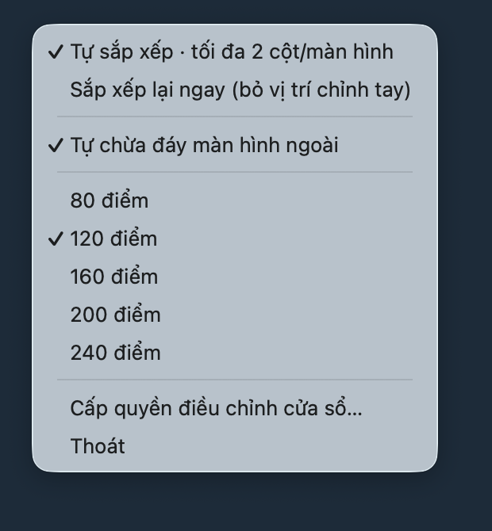
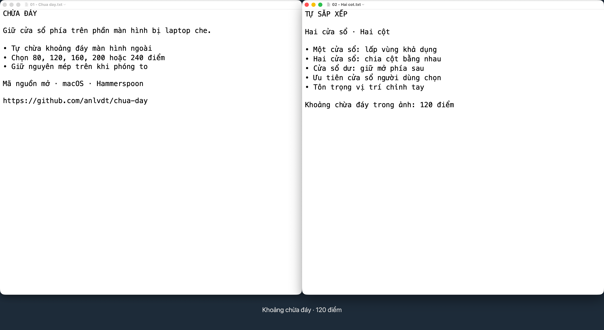

# Chừa đáy

Tiện ích macOS chạy trong [Hammerspoon](https://www.hammerspoon.org/), giúp cửa sổ trên màn hình ngoài tránh phần đáy bị màn hình laptop che. Có tùy chọn tự xếp cửa sổ thành hai cột, điều khiển qua menu tiếng Việt.

**Mã nguồn mở · MIT · Chạy cục bộ · Không cần tài khoản**

## Ảnh chụp





Ảnh dùng các tài liệu demo, không chứa nội dung cá nhân.

## Tính năng

- Tự giảm chiều cao cửa sổ trên màn hình ngoài để chừa đáy; giữ nguyên mép trên khi có thể.
- Khoảng chừa đáy: 80, 120, 160, 200 hoặc 240 **điểm macOS**; mặc định 120.
- Nhận diện màn hình tích hợp bằng thông tin hệ thống, không cần nhập UUID của máy.
- Tùy chọn **Tự sắp xếp**: một cửa sổ lấp vùng khả dụng; hai cửa sổ chia hai cột bằng nhau.
- Xếp tối đa hai cửa sổ dùng gần đây trên từng màn hình. Cửa sổ dư vẫn mở phía sau trên cùng màn hình. Bạn có thể kéo cửa sổ sang màn hình khác để đổi chỗ.
- Khi bạn chọn cửa sổ khác, ưu tiên lựa chọn đó, không giành focus.
- Giữ vị trí/kích thước bạn chỉnh tay trong phiên hiện tại, trong giới hạn khoảng chừa đáy. **Sắp xếp lại ngay** đưa cửa sổ về bố cục tự động.
- Bỏ qua cửa sổ đã thu nhỏ, ứng dụng ẩn, cửa sổ toàn màn hình, hộp thoại và các Space không hiện tại.
- Chống tự phản hồi sự kiện di chuyển cửa sổ; không dùng animation hay bước di chuyển trung gian.

## Cài đặt

Yêu cầu: macOS và Hammerspoon. Đã kiểm tra với Hammerspoon 1.1.1.

1. Cài Hammerspoon từ trang chính thức, hoặc qua Homebrew:

   ```sh
   brew install --cask hammerspoon
   ```

2. Tải mã nguồn và cài tiện ích:

   ```sh
   git clone https://github.com/anlvdt/chua-day.git
   cd chua-day
   bash install.sh
   ```

   Script sao lưu cấu hình cũ vào `~/.hammerspoon/chua-day-backup.*`, cài module vào `~/.hammerspoon/chua-day/` và thêm `require("chua-day")` vào `init.lua`. Phần cấu hình Hammerspoon sẵn có được giữ nguyên.

3. Mở Hammerspoon, cấp quyền tại **System Settings → Privacy & Security → Accessibility**, sau đó chọn **Reload Config** trong Hammerspoon.
4. Tìm menu **Chừa đáy** trên thanh menu macOS.

Nếu đã dùng bản thử nghiệm thay toàn bộ `init.lua` trước đây, hãy sao lưu bản đó rồi chuyển sang cấu hình module bên trên. Không chạy đồng thời hai bản điều khiển cửa sổ.

## Sử dụng

| Mục menu | Hành vi |
| --- | --- |
| Tự chừa đáy màn hình ngoài | Bật/tắt vùng chừa đáy; màn hình laptop không bị trừ khoảng này |
| 80–240 điểm | Chọn độ cao khoảng chừa |
| Tự sắp xếp · tối đa 2 cột/màn hình | Bật/tắt bố cục tự động; mặc định tắt khi cài mới |
| Sắp xếp lại ngay (bỏ vị trí chỉnh tay) | Bỏ các vị trí đã chỉnh tay trong phiên và xếp lại |
| Cấp quyền điều chỉnh cửa sổ… | Mở bước cấp quyền Accessibility |
| Thoát | Thoát Hammerspoon, bao gồm các tiện ích Hammerspoon khác nếu có |

Bạn có thể bật **Launch Hammerspoon at login** trong phần thiết lập Hammerspoon. Tiện ích lưu lựa chọn bật/tắt và khoảng chừa đáy; không tự thay đổi thiết lập khởi động của Hammerspoon.

## Giới hạn hiện tại

- Đây là module Hammerspoon, chưa phải ứng dụng `.app` độc lập.
- Hai cột là bố cục tự động. Nếu bạn tự đổi vị trí hoặc kích thước, các cửa sổ có thể chồng lên nhau theo lựa chọn của bạn.
- Vị trí chỉnh tay được giữ đến khi chọn xếp lại, bật/tắt bố cục, reload Hammerspoon hoặc thay đổi cấu hình màn hình.
- Các ứng dụng có kích thước tối thiểu lớn hoặc không hỗ trợ Accessibility có thể không khớp chính xác với cột. Tiện ích không cố ép lặp liên tục.
- Vùng chừa được áp dụng ở đáy tất cả màn hình ngoài, chưa mô tả được vùng che riêng cho từng màn hình.
- Chỉ di chuyển/đổi kích thước cửa sổ; không thay đổi độ phân giải, độ sáng hoặc cấu hình phần cứng.

## Gỡ cài đặt

Xóa dòng `require("chua-day")` cùng hai dòng đánh dấu `chua-day:begin/end` trong `~/.hammerspoon/init.lua`, xóa thư mục `~/.hammerspoon/chua-day/`, rồi reload Hammerspoon. Có thể khôi phục cấu hình từ thư mục sao lưu nếu cần.

## Phát triển và kiểm tra

```sh
lua tests/run.lua
bash tests/install.sh
```

Các bài kiểm tra bao gồm phân bổ màn hình, giới hạn hai cột, ưu tiên cửa sổ vừa chọn, giữ vị trí chỉnh tay, khoảng đáy khi phóng to, nhận diện màn hình tích hợp, khởi tạo module và cài đặt lặp. GitHub Actions chạy các kiểm tra này với Lua 5.4; kiểm tra này không thay thế thử nghiệm Accessibility trên macOS.

## English

Chừa đáy is a Hammerspoon module for macOS that reserves bottom clearance on external displays, useful when a laptop physically blocks their lower edge. Optional automatic layouts place up to two selected windows side by side on their current display. Surplus windows stay open behind the selected windows on the same display. Manual placement and focus choices take priority, while bottom clearance remains enforced. The menu is in Vietnamese.

Install Hammerspoon, clone this repository, run `bash install.sh`, grant Accessibility permission and reload Hammerspoon. Automatic layouts are off by default on a fresh install. See [LICENSE](LICENSE).
